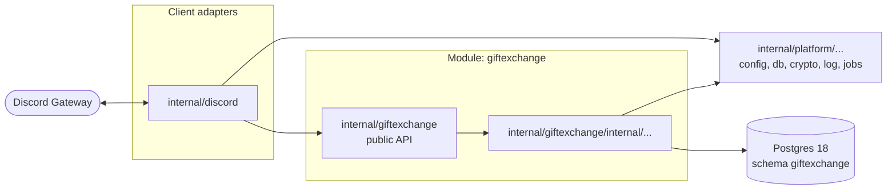

# Architecture

Chatisimo is a modular monolith: one Go binary, `cmd/chatisimo`, built from modules that call
each other in process. An arrow below means "may import or call". Anything not drawn is not
allowed.

## Modules

A module owns one domain; `giftexchange` is one. Its root package is its public API: the
interfaces, request and response types, and errors that other code uses. Everything else
lives under `internal/<name>/internal/`, where Go's `internal` rule makes it unreachable from
outside the module. Modules talk to each other only through those public APIs, in process:
there is no message broker and no shared table.

## Client adapters

`internal/discord` holds the Discord Gateway connection and turns slash commands and
interactions into public API calls. It contains no domain rules: whether a draw is valid, who
may change a setting, or what happens when a participant drops out is decided by the module.
The adapter does provide the commands to view an exchange's rules and to change the ones that
are configurable.

## Platform

`internal/platform/` holds the technical services that modules and adapters share:
configuration loading, the database pool, encryption, logging and the River job runner. It
never imports a module or an adapter. Platform also owns two schemas: `platform`, for settings and secrets,
and `river`, for River's tables, created with `CREATE SCHEMA` before River's migrations run.

## Data

Each module owns one Postgres schema with its own name. The platform schemas `platform` and `river` are the only
schemas not owned by a module. No query or foreign key crosses
schemas; a module that needs another module's data calls that module's public API. sqlc
queries and goose migrations live with their module, in `internal/<name>/internal/store/`.
Timed jobs, such as deadline draws, reminders and reveals, run on River in the same database.

## Test infrastructure

`internal/fakediscord` is a fake of the Discord REST API and Gateway with a web client, used by
tests; `cmd/fakediscord` serves it for the local e2e stack and Playwright. `e2e/` holds the Go
end-to-end tests (build tag `e2e`), which run the `-cover` build of `cmd/chatisimo` against the
fake. `cmd/coveragegate` checks merged coverage against `.coverage-floor`. No production code
imports any of them.

## Import rules

| Package | May import | Must not import |
|---|---|---|
| A module | other modules' public APIs, `internal/platform/...`, its own internals, third-party infrastructure libraries (`pgx`, River) | other modules' internals, `internal/discord`, `github.com/disgoorg/...`, `internal/fakediscord` |
| `internal/discord` | module public APIs, `internal/platform/...`, disgo | any module's internals |
| `internal/platform/...` | the standard library, third-party infrastructure libraries | any module, `internal/discord` |
| `internal/fakediscord` | the standard library, `github.com/gorilla/websocket`; disgo in its own `_test.go` files only | any other package of this repository |
| `cmd/fakediscord` | `internal/fakediscord`, the standard library | anything else of this repository |
| `e2e/` (test files only) | `internal/fakediscord`, `internal/platform/pgtest`, the standard library | modules, `internal/discord` |
| `cmd/coveragegate` | the standard library | any package of this repository |

Only `_test.go` files, `cmd/fakediscord` and `e2e/` may import `internal/fakediscord`.

Go's `internal` rule enforces the module boundary. `depguard` in `.golangci.yml` enforces the
rest on every lint run. When it fails, change the dependency; do not loosen the rule.
